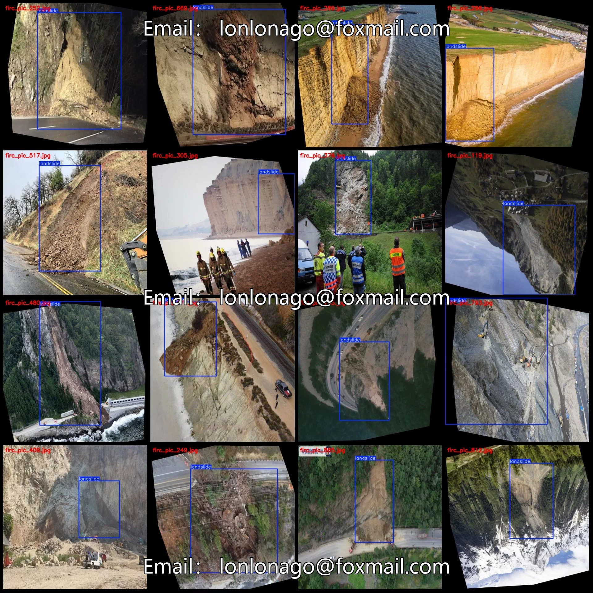
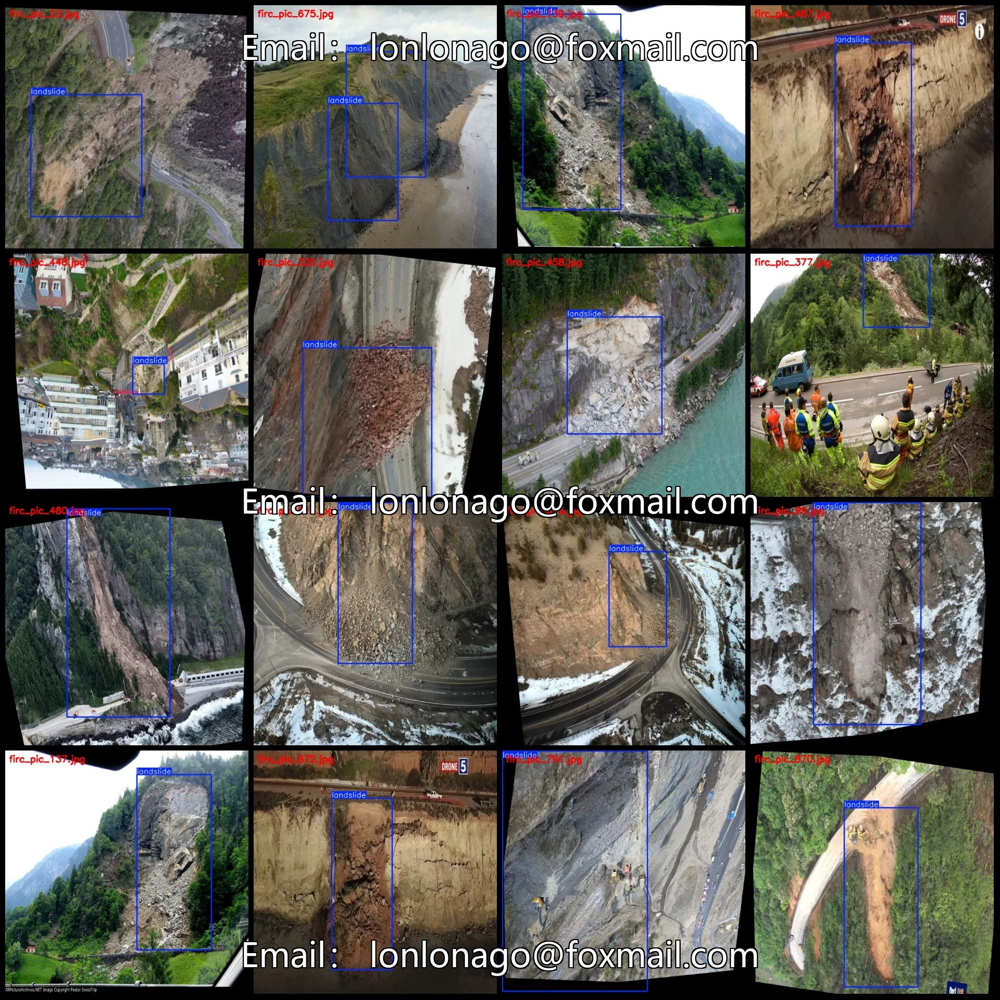
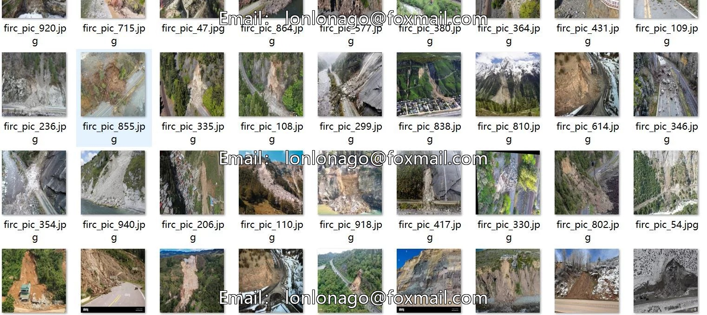
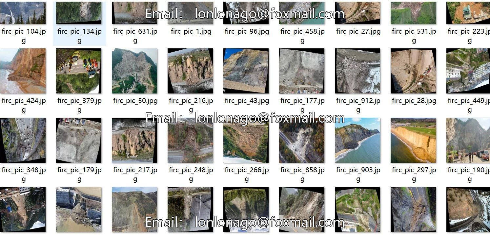

# UAV-viewed slope and landslide detection dataset in VOC+YOLO format, 968 images

## Body

Drone-View Slope and Landslide Detection Dataset - VOC+YOLO Format: 968 Images, 1 Category with Enhanced
Warm Reminder: Due to the dataset's replicability, please confirm compliance before purchasing.
Note: Approximately 390 images are original, while the remaining are rotated enhancement images. Please refer to the images for details.
Dataset Format: Pascal VOC format + YOLO format (excluding the segmentation path in the txt file, only including jpg images along with their corresponding VOC format xml files and yolo format txt files)
Number of Images (JPG File Count): 968
Number of Annotations (XML File Count): 968
Number of Annotations (TXT File Count): 968
Number of Annotation Categories: 1

Annotation Category Name: ["landslide"]
Number of boxes per category:
landslide boxes = 1026
Total number of boxes: 1026
Number of images per category:
landslide images = 968
Image resolution: 640x640
Labeling tool used: labelImg
Annotation rules: Draw a rectangle around the category.
Important Note: The dataset does not have separate training, validation, and test sets; you need to partition them yourself.
Special Remarks: This dataset does not guarantee the accuracy of the models trained or the weight files.

## Images

## Payment

Here is a pay link on Stripe ( https://buy.stripe.com/3cs8yP7sY87d0vu9AB ). Please contact me lonlonago@foxmail.com after funding $89, and I will send you a complete data files , thank you!

